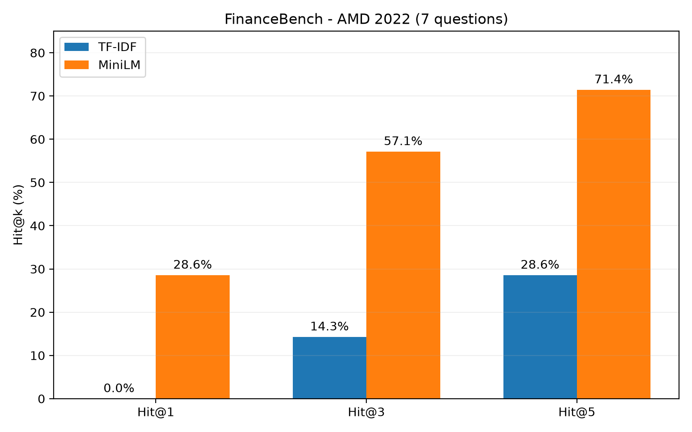

# FinRAG

Local question answering over financial documents with **TF-IDF or MiniLM retrieval**, source-aware context construction and either an extractive baseline or local **Qwen** generation.

The project keeps retrieval, context construction and generation separate so each stage can be evaluated independently. No paid API or API key is required.

## Results at a glance

The included evaluation corpus is intentionally small and controlled: **4 documents, 12 chunks, 12 answerable questions and 6 unanswerable questions**. It is useful for testing the pipeline, not as a representative financial QA benchmark.

| Retriever | Recall@1 | Recall@3 |
| --- | ---: | ---: |
| TF-IDF | **0.833** | **1.000** |
| MiniLM | 0.750 | **1.000** |

TF-IDF ranks better on this corpus, while both retrievers recover accepted evidence within the top 3 for every answerable question. With only 12 answerable questions, this does not establish a general advantage of sparse over dense retrieval.

A second check shows why retrieval score alone is not enough for answerability: the top-1 similarity ranges for answerable and unanswerable questions overlap for both retrievers, so no single score threshold cleanly separates the two.

## Pipeline

```text
TXT / Markdown / PDF → 25-word chunks, 5-word overlap
                    → TF-IDF or MiniLM → cosine ranking → top-k chunks
                    → context with sources → extractive answer or local Qwen
```

The Python pipeline implements document loading, word-based chunking with overlap, source metadata, cosine ranking, context construction and retrieval evaluation without a RAG framework. It uses scikit-learn for TF-IDF, Sentence Transformers for pretrained MiniLM embeddings and Transformers for Qwen inference; the models are not trained here.

Sparse retrieval computes cosine similarity over TF-IDF vectors. Dense retrieval uses `sentence-transformers/all-MiniLM-L6-v2`; normalized embeddings make their dot product equal to cosine similarity. Each result retains its filename, chunk id and score. Retrieval, context formatting and generation remain separate modules.

## Evaluation

Retrieval is evaluated independently of generation. Here, Recall@k means the fraction of questions with **at least one accepted evidence chunk** in the top k (also called hit rate). Questions can accept multiple chunk ids where overlap repeats evidence; this is not recall over every relevant chunk.

| Retriever | Questions | Recall@1 | Recall@3 |
| --- | --- | ---: | ---: |
| TF-IDF | All | 0.833 | 1.000 |
| TF-IDF | Lexical | 1.000 | 1.000 |
| TF-IDF | Paraphrase | 0.667 | 1.000 |
| MiniLM | All | 0.750 | 1.000 |
| MiniLM | Lexical | 0.833 | 1.000 |
| MiniLM | Paraphrase | 0.667 | 1.000 |

TF-IDF ranks better on this particular corpus. With only six lexical and six paraphrased questions, this does not establish a general advantage over dense retrieval. The comparison script regenerates `results/retrieval_metrics.json`.

Raw similarity did not reliably determine whether an answer existed in the corpus:

| Retriever | Lowest answerable top-1 score | Highest unanswerable top-1 score |
| --- | ---: | ---: |
| TF-IDF | 0.2107 | 0.3670 |
| MiniLM | 0.4865 | 0.7287 |

The score ranges overlap. Similarity is useful for ranking, but no single score cutoff separates these answerable and unanswerable questions.

## Run

Use Python 3.11 or newer. From the repository root:

```bash
python -m venv .venv
source .venv/bin/activate
pip install -e ".[dev]"
pytest -q
python scripts/compare_retrievers.py
python scripts/analyze_confidence.py

finrag "What was Northstar's operating profit?" --retriever tfidf --generator extractive
finrag "What was Northstar's operating profit?" --retriever minilm --generator qwen
finrag "What dividend per share did Northstar distribute?" --retriever minilm --generator qwen
```

The default corpus is `data/raw` relative to the current directory. Use `--corpus PATH` from another directory or for your own documents. `--k` defaults to 3. The evaluation scripts always use the included corpus.

The first model run downloads weights from Hugging Face; no paid API or API key is required. After caching the weights, `HF_HUB_OFFLINE=1` disables Hub checks. Qwen uses Apple Silicon MPS when available and otherwise CPU; CPU generation can be slower. Models are loaded once per CLI invocation, and corpus embeddings are computed on each dense retriever fit.

## Generation checks and limitations

`Qwen/Qwen2.5-0.5B-Instruct` receives the retrieved evidence and an instruction to answer from it or return `INSUFFICIENT_EVIDENCE`. In the manual checks on Apple Silicon MPS:

| Question | Qwen output |
| --- | --- |
| What was Northstar's operating profit? | €58 million |
| What dividend per share did Northstar distribute? | INSUFFICIENT_EVIDENCE |

An explicit CPU check returned `€58 million` for profit but **`0.5434` for the unsupported dividend question**, copying a retrieval score. This passed output validation. Greedy decoding did not produce the same answer across these devices; the MPS abstention example is not a portable guarantee.

The CLI prints the source chunks and scores separately. The supported answer omitted the requested inline citation. Validation rejects empty or punctuation/citation-only output, invalid citation indices and explicit abstention. Passing validation does **not** establish factual support.

During development, one prompt returned only `[1]` for the unsupported question; a stricter prompt then rejected a supported question. The simpler prompt is retained. These manual examples do not demonstrate reliable abstention or hallucination control, and generation has not been evaluated systematically.

The extractive baseline returns the highest-ranked chunk, not a synthesized answer. Its optional `--min-score` is only a retrieval cutoff, not an answerability detector; unrelated questions can still receive text.

Word boundaries can split sentences and tables. PDF loading extracts embedded text without OCR, layout reconstruction or page-level citations; scanned PDFs may yield no text, and malformed PDFs can fail parsing. The hand-written relevance labels and tiny corpus limit the evaluation. There is no reranker or persistent index. Real financial reports and independently checked evidence labels would be needed before making broader quality claims.

## FinanceBench: AMD exploratory study

We evaluated page-level evidence retrieval on AMD's 2022 10-K using seven questions from FinanceBench.

The report contains 121 PDF pages. We generated 998 chunks using 80 words per chunk and 15 words of overlap. All chunks were within MiniLM's 256-token input limit.

### Retrieval results

| Method | Hit@1 | Hit@3 | Hit@5 |
| --- | ---: | ---: | ---: |
| TF-IDF | 0.000 | 0.143 | 0.286 |
| MiniLM | 0.286 | 0.571 | 0.714 |



Chunks are ranked by cosine similarity. Page rankings are obtained using the highest-scoring chunk per page. Hit@k measures whether at least one FinanceBench-annotated evidence page appears among the top-k distinct pages.

MiniLM outperformed TF-IDF on this small AMD subset, but the result does not establish general superiority. The quick-ratio question remains difficult for both methods.

These are exploratory development results, not held-out benchmark performance.

### Reproduction

Install the project with development dependencies and place the AMD 2022 10-K PDF and FinanceBench annotations in `data/external/financebench/`.

```bash
PYTHONPATH=src python scripts/evaluate_amd.py
PYTHONPATH=src python scripts/compare_amd_chunks.py
python scripts/plot_amd.py
```

The scripts generate JSON metrics and figures in `results/`.

FinanceBench annotations: https://github.com/patronus-ai/financebench
## FinanceBench: multi-document development pilot

We evaluated TF-IDF and MiniLM on 28 FinanceBench questions from six financial reports (7,540 chunks). Retrieval is restricted to the report associated with each question, using 80-word chunks with 15-word overlap.

| Method | Any-evidence Hit@5 | All-evidence Hit@5 |
| --- | ---: | ---: |
| TF-IDF | 39.3% | 32.1% |
| MiniLM | 53.6% | 46.4% |

Any-evidence Hit@k requires at least one annotated evidence page within the top k distinct pages. All-evidence Hit@k requires every annotated page within the top k.

Four questions require multiple evidence pages. MiniLM performs better overall, but TF-IDF performs better on some individual reports.

These are exploratory development results, not held-out benchmark results. Page-level evidence retrieval does not establish answer correctness.

One of 7,540 chunks exceeds MiniLM's 256-token limit (264 tokens, Boeing page 48). It is not on an annotated evidence page, but truncation may still affect rankings. Word-based chunking and PDF table extraction remain limitations.

### Reproduction

Download the six matching PDFs and the public FinanceBench annotations from https://github.com/patronus-ai/financebench.

```bash
PYTHONPATH=src python scripts/prepare_financebench.py
PYTHONPATH=src python scripts/evaluate_financebench_pilot.py

```
