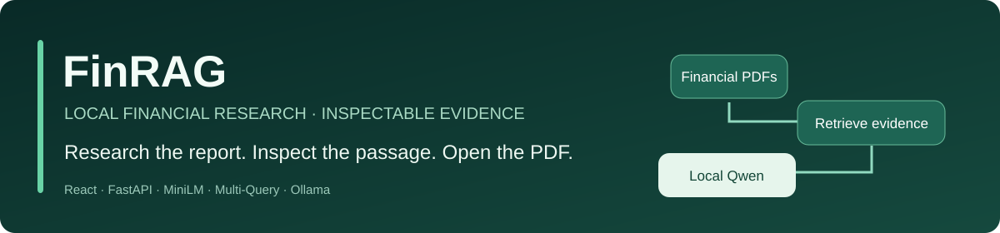
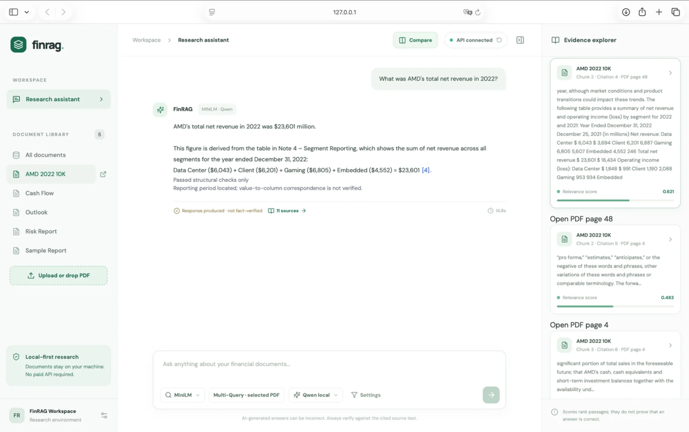
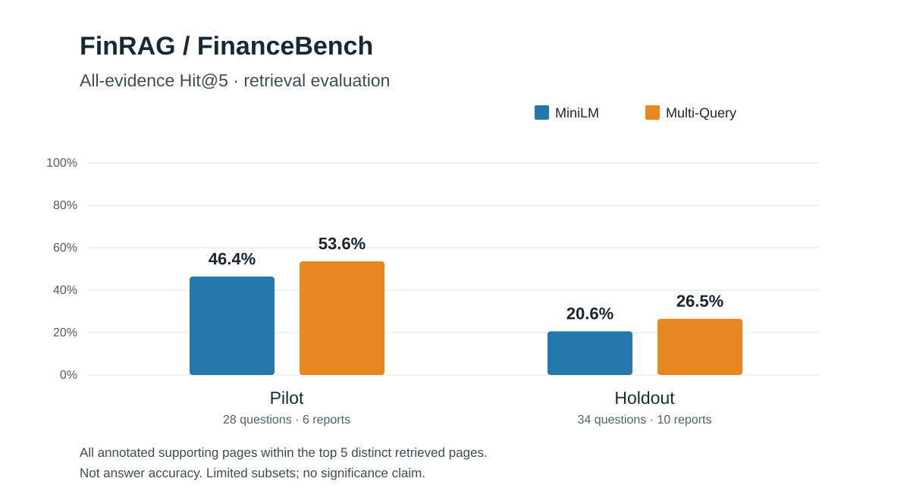

# FinRAG

<p align="center"></p>

<p align="center">
  <strong>Financial PDFs → retrieval → inspectable evidence → local generation</strong>
</p>

<p align="center">
  <a href="#workspace">Workspace</a> ·
  <a href="#retrieval-evaluation">Evaluation</a> ·
  <a href="#running-locally">Run locally</a> ·
  <a href="#limitations-and-safety">Limitations</a>
</p>

**Local financial-document question answering with inspectable evidence and measurable retrieval.**

FinRAG is a Python and React research application for asking questions about financial reports. It combines document retrieval, local language-model generation, and a workspace where users can inspect the underlying passages and open the corresponding PDF pages. The repository includes controlled retrieval experiments on [FinanceBench](https://github.com/patronus-ai/financebench).

**No paid LLM API or API key is required for inference.** The app is intended to run on a local machine, not as an internet-facing service. Model acquisition and some frontend assets may require an initial network connection.

**Project status (October 2026):** The integrated application is published on `main` and has passed Python and web CI. It remains a local research system rather than a hosted or production service.

## Why this project

A financial question may require facts from several pages, the correct reporting period, and arithmetic. Finding passages that look relevant is not the same as producing a correct answer. FinRAG makes those stages inspectable instead of treating a plausible model response as proof.

The system was developed to answer practical engineering questions: How do lexical and semantic retrieval compare? Can citations be traced to an original report? When does a local model abstain incorrectly? What would be needed to calculate financial quantities without delegating arithmetic to a language model?

## Workspace

The integrated interface includes chat, document library, PDF upload, Evidence Explorer, original-PDF page links, response states, a sparse-versus-dense retrieval comparison, and a selectable Multi-Query mode for a single PDF.

The workspace makes each response explorable: read the answer, inspect the passages behind its citations, and open the original report at the referenced page.

**Example workflow:** ask for AMD's FY2022 net revenue, inspect the cited 10-K passage, and confirm the figure in the original report. Screenshots taken with real local inference are kept distinct from mocked browser-test previews.

### FinRAG in action



*Local Qwen inference with inspectable evidence. The financial figure was manually checked against the report; answers are not automatically fact-verified.*

## Architecture

```text
Financial PDFs / local text reports
               |
        Text extraction + chunking
               |
   Document + page/source provenance
               |
        Retrieval / ranking
        |             |
  TF-IDF, MiniLM    Research variants:
                    BM25, RRF, Multi-Query,
                    Cross-Encoder reranking
               |
     Retrieved evidence + provenance
               |
   Answer / insufficient-context decisions
               |
  Local Qwen via Ollama (integrated build)
               |
    Response + status + source references
               |
       FastAPI <----> React / Vite
               |
    Chat, evidence explorer, PDF viewer
```

Python owns extraction, retrieval, evidence handling, model inference, and response status. FastAPI exposes these results; React displays them without recomputing retrieval or financial figures. The UI's retrieval comparison is a qualitative diagnostic, not a substitute for benchmark evaluation.

**Scope:** the default branch includes the integrated FastAPI + Ollama path described here. This is a local research workflow, not a deployed public service.

## Stack

| Layer | Technology |
| --- | --- |
| Backend/API | Python (tested locally with 3.13), FastAPI, Pydantic, Uvicorn |
| Frontend | React, Vite, application CSS, Lucide icons |
| Lexical retrieval | TF-IDF with scikit-learn; BM25 investigated separately |
| Semantic retrieval | Sentence Transformers / MiniLM |
| Retrieval experiments | RRF fusion, Multi-Query, Cross-Encoder reranking |
| Local generation | Ollama + `qwen3:4b-instruct` (integrated version) |
| PDF extraction | pypdf, with PDF page/source provenance |
| Tests | pytest, frontend/browser tests with Playwright |

The project uses individual retrieval and inference components rather than relying on a managed RAG service. **Models are pretrained, not fine-tuned as part of this project.**

## What works

**Verified in the integrated local application:**

- Upload and consultation of text-based financial PDFs through the React workspace.
- Document-scoped queries, evidence inspection, and links to original PDF pages.
- TF-IDF, MiniLM, and Multi-Query available in the local application.
- Local generation with Ollama/Qwen3, with distinct insufficient-context, model-abstention, and technical-error states.
- A comparison view for sparse and dense retrieved passages.
- Correctly retrieved/reported AMD net revenue figures for FY2022 (**$23,601 million**) and FY2021 (**$16,434 million**) in the reported local checks. These are individual case checks, **not** a measured answer-accuracy rate.

**Additional retrieval research:** BM25, RRF fusion, and Cross-Encoder reranking are included in the experiment code. The React workspace exposes TF-IDF, MiniLM, and Multi-Query.

## Retrieval evaluation

### FinanceBench page retrieval

These results come from separate pilot and holdout research evaluations. They measure **retrieval coverage, not end-to-end answer correctness**. Reproducing the exact holdout scores from a clean clone still requires verification of the benchmark document manifest, settings, and external data access.

| Split | Questions | Reports | MiniLM all-evidence Hit@5 | Multi-Query all-evidence Hit@5 |
| --- | ---: | ---: | ---: | ---: |
| Pilot | 28 | 6 | 46.4% | 53.6% |
| Holdout | 34 | 10 | 20.6% | 26.5% |




**All-evidence Hit@5** is the fraction of questions for which **every annotated supporting page** occurs within the five highest-ranked distinct pages for the relevant report. It is stricter than finding at least one supporting page. It does not assess whether the generator used the pages correctly or produced the right number.

The lower holdout scores are material. They show that evidence recovery is far from solved and that pilot improvements should not be presented as broad reliability claims. To describe these results as independently reproducible, publish the corresponding experiment settings, document manifest, evaluation commands, and permitted artifacts; downloaded reports need not be redistributed.

### Adaptive budget experiment (not adopted)

An experimental selector replaced Multi-Query's fixed two-chunks-per-page quota with a per-question
evidence budget and one citation ID per contiguous evidence span. On a frozen 34-question,
10-report holdout it increased structurally produced answers from 8/34 to 10/34, but annotated
evidence presence fell from 7/46 to 3/46 spans, and the three gained answers had no annotated
evidence span in their context. Provisional AI-assisted grading found incorrect and unsupported
outputs under both configurations and no verified factual-accuracy improvement. The candidate was
**not adopted**; its experimental code is **not merged** into `main`.

See [docs/financebench_experiments.md](docs/financebench_experiments.md) for the paired protocol,
exact structural metrics, semantic denominators, failure examples and limitations.

### Small synthetic regression corpus

The project also includes a controlled synthetic example with **4 documents, 12 chunks, and 12 answerable questions** (plus 6 unanswerable questions used to study score overlap). It is useful for verifying retrieval code, **not** for benchmarking real financial QA.

| Retriever | At least one accepted chunk @1 | @3 |
| --- | ---: | ---: |
| TF-IDF | 83.3% | 100.0% |
| MiniLM | 75.0% | 100.0% |

The small-corpus script calls this metric `Recall@k`, but its operational definition is an **any-evidence hit rate**: at least one accepted chunk in top-k. It is not the same as the FinanceBench **all-evidence** measure above. Do not compare these two tables as equivalent experiments.

### Failure analysis

In **39 real Ollama inferences** across several evidence/prompt conditions, the retrieval stage supplied the required figures for a financial calculation, while generation could abstain, omit components, or describe arithmetic incorrectly. These observations motivate a strict separation between retrieving evidence and verifying numeric claims.

## Running locally

**Verified environment:** macOS with Python 3.13, local Ollama (`qwen3:4b-instruct`) and React/Vite. Other platforms may require setup adjustments. The service is designed for local use, not public deployment.

For a new checkout, prepare the Python and JavaScript environments (Python version compatibility below 3.13 is not asserted here):

```bash
python3 -m venv .venv
source .venv/bin/activate
python -m pip install -e ".[dev]"
cd web
npm ci
cd ..
```

The frontend requires Node.js `^20.19.0 || >=22.12.0`, matching the installed Vite release.

Install [Ollama](https://ollama.com/) separately, start its local service, and fetch the intended model:

```bash
ollama pull qwen3:4b-instruct
```

If a Qwen query returns `backend_error`, confirm Ollama is listening on `127.0.0.1:11434` and that `qwen3:4b-instruct` appears in `ollama list`. The workspace response repeats this recovery step.

Run backend and frontend in **separate terminals** from the repository root:

```bash
# Terminal A
source .venv/bin/activate
PYTHONPATH=src python -m uvicorn finrag.api:app --host 127.0.0.1 --port 8000
```

```bash
# Terminal B
cd web
npm run dev
```

Open `http://127.0.0.1:5183/` and use a single local PDF for Multi-Query mode. The Vite proxy forwards `/api` to the loopback FastAPI server. See [`docs/api.md`](docs/api.md) for the API contract. Model/download dependencies require an initial network connection.

### Tests and quality checks

Install Playwright's Chromium build once before running the browser suite:

```bash
cd web && npx playwright install chromium
```

The integrated tree passed these local checks on 20 October 2026; the Python and web GitHub Actions workflows also passed before the integration PR was merged:

| Check | Local result | Scope |
| --- | --- | --- |
| `PYTHONPATH=src python -m pytest -q` | **146 passed**, one third-party deprecation warning | Python / API |
| `ruff check .` | **Passed** | Python lint |
| `cd web && npm test` | **9 passed** | Frontend logic |
| `cd web && npx playwright test --reporter=line` | **17 passed** | Browser/UI flows, primarily mocked HTTP responses |
| `cd web && npm run build` | **Passed** | Production frontend build |

The Playwright run is **not** a browser-to-real-Ollama accuracy benchmark. Separately, real local AMD 2022/2021 questions returned the expected revenue figures, and an unsupported FY2040 request produced `insufficient_context`; these are manual cases, not statistical accuracy estimates. The automated CI covers Python tests and the web build/browser suite; frontend unit tests and lint were also run locally. These checks do not establish end-to-end factual answer accuracy.

## Limitations and safety

- **Citations are inspectable, not automatically fact-verified.** Their correctness still needs complete checking, including page correspondence, periods, and numeric support.
- Qwen may abstain despite sufficient retrieved evidence. A non-abstaining answer may still be wrong.
- Financial numbers and arithmetic should be checked against the original report; the system does not certify them.
- Retrieval scores are ranking signals, not probabilities of factual correctness. Scores from different methods should not be directly compared as calibrated confidence.
- PDF extraction can lose table structure and may not work for scans or password-protected documents. No OCR pipeline has been validated for this release.
- The app is intended for **local, single-user research**. It does not offer a hardened authentication or deployment security model. Do **not** expose its API to the internet.
- The results above are retrieval evaluations from limited question/report subsets; they do not establish general financial-answer accuracy or production readiness.

## Validation provenance

The integrated application was merged into `main` through [pull request #4](https://github.com/samugc/FinRAG/pull/4) after both Python and Web CI passed. Historical PDF-upload work was consolidated and its separate PR closed. Browser previews produced by CI use deterministic mocked API responses; manually verified AMD financial figures come from separate local sessions. Neither constitutes automated factual validation of generated answers.

## Data, attribution, and license

**Third-party data:** FinanceBench is developed by Patronus AI. The FinanceBench dataset is licensed under [CC BY-NC 4.0](https://creativecommons.org/licenses/by-nc/4.0/). The evaluation manifests and derived results in this repository use FinanceBench annotations and must respect that license. The project's MIT license applies to original FinRAG code, not to third-party datasets, financial reports, or model weights.


FinanceBench is an external benchmark by its original authors. This project evaluates against it; it does not claim ownership of its annotations or of companies' annual reports. Before releasing assets, confirm redistribution terms and avoid committing downloaded third-party PDFs unless permitted.

**License:** The original FinRAG code is released under the [MIT License](LICENSE). Third-party datasets, pretrained models, PDF filings, fonts and dependencies retain their own licenses and redistribution conditions.

---

**Project:** [github.com/samugc/FinRAG](https://github.com/samugc/FinRAG)

**Status:** published local research application; **not a production financial-advice tool**.
